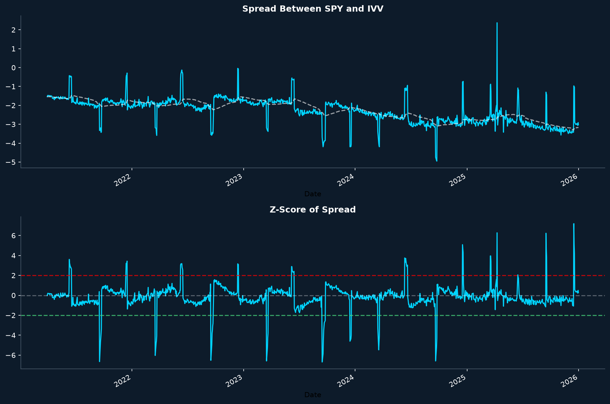

# Pairs Trading Strategy on Cointegrated ETFs

Iimplementation of a cointegration based pairs trading strategy, inspired by the methodology of Chen and Alexiou (2025). The strategy trades the pair SPY and IVV, two ETFs that track the S&P 500 index, exploiting short term deviations of their price relationship from its historical mean.

## Idea

Pairs trading is a market neutral strategy. When two assets share a stable long run price relationship, temporary deviations from that relationship tend to revert. The strategy goes long the relatively cheap asset and short the relatively expensive one, waiting for the spread to converge back to its mean (Gatev, Goetzmann and Rouwenhorst, 1999).

The statistical foundation is cointegration: two price series are cointegrated if each one is non stationary but a linear combination of the two is stationary (Engle and Granger, 1987). Note that cointegration is not correlation. Two assets can move together in the short run without maintaining a stable long run equilibrium, and cointegration is designed to capture exactly that long run link.

## Methodology

The pipeline follows the framework described in Chen and Alexiou (2025):

1. **Data.** Daily closing prices of SPY and IVV downloaded from Yahoo Finance over the period 2021 to 2026.
2. **Cointegration test.** The Engle and Granger two step test, through `coint()` from statsmodels, checks whether the residuals of the linear relationship between the two prices are stationary. The null hypothesis is no cointegration, tested at the 5 percent level.
3. **Spread and z-score.** The spread is computed and standardized with a rolling mean and a rolling standard deviation over a 60 day window, producing a z score that measures how far the spread is from its recent average.
4. **Signal generation.** Following the thresholds used in the paper and in Avellaneda and Lee (2010): when the z-score rises above 2 the strategy shorts SPY and buys IVV, when it falls below minus 2 the strategy buys SPY and shorts IVV, and positions are closed when the absolute z score falls below 0.5. Positions are held between signals through forward filling.
5. **Backtest.** The strategy return at day t uses the signal from day t - 1, which avoids look ahead bias. Annualized return and Sharpe ratio are reported.

## Simplifications of this first version

This is intentionally a first, easy and linear approach. Compared to the full methodology of the paper, three simplifications are made:

* **Spread as a price difference.** The spread is computed as the simple difference between the two prices instead of the price ratio used in the paper. Since SPY and IVV trade at very similar price levels, the two definitions behave almost identically here, as the authors themselves observe when comparing the price ratio approach with the Engle and Granger spread.
* **No transaction costs.** Results are gross of commissions and bid ask spread. The paper notes that for SPY and IVV the detected mean reversion is very tight, so real world frictions would absorb a large part of the gross profit. Adding a per trade cost is the natural next step.
* **Single cointegration test over the whole sample.** The test is run once over the full period instead of on rolling 200 day windows re evaluated every month as in the paper. The rolling approach is more realistic, since the paper shows that cointegration relationships are often transient, but the full sample test keeps this first version simple.

## Output

The script prints the cointegration p value, the annualized return and the Sharpe ratio, and produces the chart below: the upper panel shows the spread between SPY and IVV with its rolling mean, the lower panel shows the z score with the entry thresholds at plus and minus 2.



## Requirements

Install the dependencies listed in `requirements.txt` and run:

```bash
python pairs_trading_strategy.py
```

Main libraries: `yfinance`, `pandas`, `numpy`, `statsmodels`, `matplotlib`.

## References

* Chen, K. and Alexiou, C. (2025). Cointegration-based pairs trading: identifying and exploiting similar exchange-traded funds. *Journal of Asset Management*, 26, 464 to 488. [https://doi.org/10.1057/s41260-025-00416-0](https://doi.org/10.1057/s41260-025-00416-0)
* Engle, R. and Granger, C.W.J. (1987). Co-integration and error correction: representation, estimation, and testing. *Econometrica*, 55(2), 251 to 276.
* Gatev, E., Goetzmann, W. and Rouwenhorst, G. (1999). Pairs trading: performance of a relative value arbitrage rule. NBER Working Paper 7032.
* Avellaneda, M. and Lee, J.H. (2010). Statistical arbitrage in the U.S. equities market. *Quantitative Finance*, 10(7), 761 to 782.
* Rad, H., Low, R. and Faff, R. (2016). The profitability of pairs trading strategies: distance, cointegration, and copula methods. *Quantitative Finance*, 16(10), 1541 to 1558.
